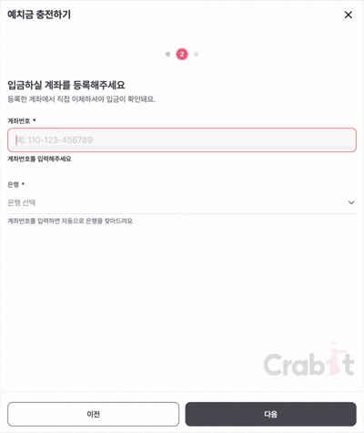

# korean-account

[](https://www.npmjs.com/package/korean-account)
[](https://github.com/dydals3440/korean-account/actions/workflows/ci.yml)
[](https://www.npmjs.com/package/korean-account)
[](https://github.com/dydals3440/korean-account/blob/main/LICENSE)

[English](https://github.com/dydals3440/korean-account/blob/main/docs/README.en.md) · **한국어**

**계좌번호만 보고 어느 은행·증권사 계좌인지 후보를 찾아 주는 TypeScript 라이브러리입니다.**
금융결제원 CMS 계좌번호체계를 규칙으로 옮겼습니다. 네트워크 호출과 런타임 의존성이 없고, 필요한 기관만 골라 번들에 넣을 수 있습니다.

```ts
import { detectBest } from "korean-account";

detectBest("3333-12-3456789");
// => { institution: { id: "kakao", nameKo: "카카오뱅크", ... }, confidence: "high", ambiguous: false, ... }
```

<p align="center">
  
</p>

## 왜 만들었나

송금·자동이체 화면에서 사용자는 계좌번호와 함께 은행을 직접 골라야 합니다. 예금주 조회 API도 은행 코드를 먼저 받습니다. [볼타](https://docs.bolta.io/docs/api-introduction/bank-account-holder)는 `bankCode`, [포트원](https://developers.portone.io/api/rest-v2/platform.account)은 경로의 `bank`, [금융결제원 오픈뱅킹](https://developers.kftc.or.kr/dev/openapi/open-banking/account)은 `bank_code_std`가 필수입니다. 은행을 잘못 고르면 조회가 실패하고 사용자는 다시 입력해야 합니다.

특히 **NH농협은행(011)과 지역 농·축협(012)** 은 이름이 비슷해 자주 헷갈립니다. 농협은행도 FAQ에서 두 기관을 [구분해서 확인하라고 안내](https://www.nhbank.com/goSubPage.do?srchGb=KO_NHCP_09_07&srchSiteGb=KR)합니다. korean-account는 PDF에 적힌 계좌구분·과목 코드로 둘을 나눕니다.

계좌번호로 은행을 추천하는 기능은 예금주 조회 API가 제공하지 않아서, 큰 서비스는 직접 만듭니다(예: [토스의 은행 추천](https://toss.tech/article/toss-money-transfer-bank-recommendation)). korean-account는 그 첫 단계를 공개 자료만으로, 무료로, 오프라인에서 할 수 있게 합니다.

> [!NOTE]
> 공개된 예금주 조회 단가(2026-11-14 확인): [팝빌](https://www.popbill.com/Pricing) 성명조회 50원·실명조회 80원, [볼타](https://docs.bolta.io/docs/api-introduction/pricing) 50원(조회 성공 시), 금융결제원 오픈뱅킹 계좌실명조회 이용기관 수수료 15원·경감 8원([2021년 기준](https://fsc.go.kr/no010101/75016)). 부가세 포함 여부는 각 요금표를 확인하세요.

## 특징

- **근거 기반 신뢰도**: 식별자·과목 코드·조건 분기가 맞아야 `medium` 이상이 됩니다. 길이만 맞는 번호는 항상 `low`입니다.
- **모호성 표시**: 같은 신뢰도에 다른 기관이 있으면 `ambiguous: true`입니다. 그대로 확정하지 말고 사용자에게 고르게 하세요.
- **PDF 서비스 열**: 가상계좌 발급·출금이체·입금이체·부가서비스 가능 여부를 `capabilities.services`로 돌려줍니다.
- **타입 안전**: 기관 ID가 리터럴 유니온으로 좁혀지고, 기관을 골라 만든 detector는 결과 타입도 그 기관들로 좁혀집니다.
- **작은 번들**: 전체 레지스트리는 11.9 kB이고, `createDetector([kb, shinhan, toss])`처럼 고르면 4.6 kB입니다(minify + brotli).
- **검증 어댑터**: Standard Schema(의존성 없음), Zod 3·4, Valibot, Yup, ArkType용 스키마를 같은 규칙으로 제공합니다.

## 설치

```sh
pnpm add korean-account
```

Node.js 22.12 이상과 최신 브라우저를 지원합니다. ESM과 CommonJS를 모두 제공합니다.

## 빠른 시작

```ts
import { detect } from "korean-account";

for (const candidate of detect("110-436-387740", { limit: 3 })) {
  console.log(candidate.institution.nameKo, candidate.confidence, candidate.ambiguous);
}
// 신한은행 high true
// 우체국 high true
// 신협중앙회 high true
```

후보는 신뢰도 등급, 점수, 사전확률 순서로 정렬됩니다. 각 후보에는 계좌 종류(`kind`), 과목(`subject`), 표준 표기(`formatted`), 점수(`score`), 신뢰도(`confidence`), 모호성(`ambiguous`), 정적 능력(`capabilities`)이 들어 있습니다. 하이픈·공백·전각 숫자는 그대로 넣어도 됩니다.

### 권장 흐름: 추정 → 사용자 확인 → 실명 조회

> [!IMPORTANT]
> 결과는 **번호 체계상 가능한 후보**입니다. 계좌가 실제로 있는지, 예금주가 누구인지는 알려 주지 않습니다.

1. 입력하는 동안 `detect`로 후보를 보여 줍니다. 첫 후보가 `high`이고 `ambiguous`가 `false`면 미리 선택해 둬도 됩니다.
2. 그 밖의 경우에는 후보 목록을 보여 주고 사용자가 은행을 확정하게 합니다.
3. 확정한 은행 코드로 예금주 조회 API를 호출합니다.

```ts
import { detect } from "korean-account";

function suggestBank(input: string) {
  // partial: 입력 중에도 앞자리로 후보를 제안합니다(완성된 번호의 결과는 같음).
  const candidates = detect(input, { limit: 3, partial: true });
  const [top] = candidates;
  const isConfident = top !== undefined && top.confidence === "high" && !top.ambiguous;
  return { preselected: isConfident ? top.institution : null, candidates };
}
```

### 농협은행과 지역 농·축협

| 입력               | 결과                                |
| ------------------ | ----------------------------------- |
| `301-0123-4567-11` | `nh` NH농협은행, `high`             |
| `302-0123-4567-12` | `nh` NH농협은행, `high`             |
| `351-0123-4567-13` | `nh-coop` 지역 농·축협(012), `high` |
| `356-0123-4567-15` | `nh-coop` 지역 농·축협(012), `high` |

13자리 계좌는 끝자리(계좌구분)가 1·2면 농협은행, 3·4·5면 지역 농·축협입니다. 14자리 구계좌와 가상계좌 규칙은 [기관 목록](https://github.com/dydals3440/korean-account/blob/main/docs/registry.md)에 있습니다.

## 번들 줄이기

`detect`·`detectBest`·`getInstitution`은 전체 레지스트리를 포함합니다. 지원할 기관이 정해져 있으면 `createDetector`에 그 기관만 넘기세요.

```ts
import { createDetector, kb, shinhan, toss } from "korean-account";

const detector = createDetector([kb, shinhan, toss]);
detector.detect("110-436-387740")[0]?.institution.id;
// => "shinhan" (타입: "kb" | "shinhan" | "toss")
```

규칙·가중치·기관을 덧붙이는 방법은 [커스터마이즈](https://github.com/dydals3440/korean-account/blob/main/docs/customization.md)에 있습니다.

## 검증 어댑터

쓰는 검증 라이브러리의 서브패스만 import하세요. 어댑터는 레지스트리를 번들에 넣지 않습니다.

| import 경로                      | peer         |
| -------------------------------- | ------------ |
| `korean-account/standard-schema` | 없음         |
| `korean-account/zod`             | Zod 3 또는 4 |
| `korean-account/valibot`         | Valibot 1    |
| `korean-account/yup`             | Yup 1        |
| `korean-account/arktype`         | ArkType 2    |

```ts
import { createAccountSchema, detectionSchema } from "korean-account/zod";

// 폼 입력: 숫자·공백·하이픈(전각 포함), 6–20자리. 메시지는 키별로 바꿀 수 있습니다.
const accountSchema = createAccountSchema({ messages: { required: "계좌번호를 입력하세요." } });

// 서버: 클라이언트가 toDetectionPayload(result)로 보낸 값을 검증합니다.
const payload = detectionSchema.parse(await request.json());
```

## 예금주 조회 API와 무엇이 다른가

|                       | korean-account      | 예금주 조회 API           |
| --------------------- | ------------------- | ------------------------- |
| 은행 없이 후보 추론   | 가능                | 호출자가 은행 코드를 지정 |
| 계좌 존재·예금주 확인 | 불가                | 가능                      |
| 비용·네트워크         | 무료, 오프라인      | 건당 과금, 계좌번호 전송  |
| 근거                  | 금융결제원 PDF 규칙 | 실제 계좌 조회            |

둘은 경쟁 관계가 아닙니다. korean-account로 은행을 맞혀 두고, 확정한 은행으로 예금주를 조회하세요.

### 한계

- 같은 번호 체계를 쓰는 기관은 번호만으로 가를 수 없습니다. 예를 들어 `110-436-387740`은 신한·우체국·신협 형식에 모두 맞습니다. 이때 `ambiguous`가 `true`입니다.
- 검증번호 알고리즘은 공개되지 않아 내장하지 않았습니다. 알고 있다면 `checkDigitVerifiers`로 넣을 수 있습니다.
- 기본값은 입력이 패턴 길이에 가까워졌을 때(±1자리) 후보를 냅니다. 입력 중 앞자리로 제안하려면 `detect(input, { partial: true })`를 씁니다. 이때 후보는 항상 `low`이므로 목록으로만 보여 주고 미리 선택하지 않습니다.
- `capabilities`는 PDF에 적힌 정적 정보입니다. 실제 자동이체 가능 여부는 기관과 계약 조건에 따라 다릅니다.
- 레지스트리는 금융결제원 「참가기관별 CMS 계좌번호 체계」(2026.05.08, [2026.11.11 게시](https://www.cmsedi.or.kr/cms/board/workdata/view/1031)) 기준입니다. 원문과의 차이와 해석은 [PDF 대조 기록](https://github.com/dydals3440/korean-account/blob/main/docs/source-audit.md)에 있습니다.

## 문서

| 문서                                                                                         | 내용                                    |
| -------------------------------------------------------------------------------------------- | --------------------------------------- |
| [API](https://github.com/dydals3440/korean-account/blob/main/docs/api.md)                    | 모든 export, 옵션 기본값, 반환 타입     |
| [점수와 신뢰도](https://github.com/dydals3440/korean-account/blob/main/docs/scoring.md)      | 가중치, 신뢰도 기준, 모호성, 평가 지표  |
| [커스터마이즈](https://github.com/dydals3440/korean-account/blob/main/docs/customization.md) | 커스텀 기관·규칙·가중치·검증번호        |
| [통합 예제](https://github.com/dydals3440/korean-account/blob/main/docs/recipes.md)          | 폼 라이브러리, 서버 검증, 실명조회 연동 |
| [기관 목록](https://github.com/dydals3440/korean-account/blob/main/docs/registry.md)         | 57개 기관의 번호 체계                   |
| [PDF 대조 기록](https://github.com/dydals3440/korean-account/blob/main/docs/source-audit.md) | 원문 판본, 정정 내역, 해석 정책         |
| [마이그레이션](https://github.com/dydals3440/korean-account/blob/main/docs/migration.md)     | 버전별 바뀌는 동작                      |

## 기여

버그 제보에는 기관, 기대한 결과, 재현용 가상 번호, PDF 쪽수를 적어 주세요. 실제 계좌번호는 올리지 마세요. 개발 환경과 규칙은 [기여 안내](https://github.com/dydals3440/korean-account/blob/main/CONTRIBUTING.md)에 있습니다.

## License

[MIT](https://github.com/dydals3440/korean-account/blob/main/LICENSE). 포함된 외부 코드의 고지는 [THIRD_PARTY_NOTICES](https://github.com/dydals3440/korean-account/blob/main/THIRD_PARTY_NOTICES.md)에 있습니다.
